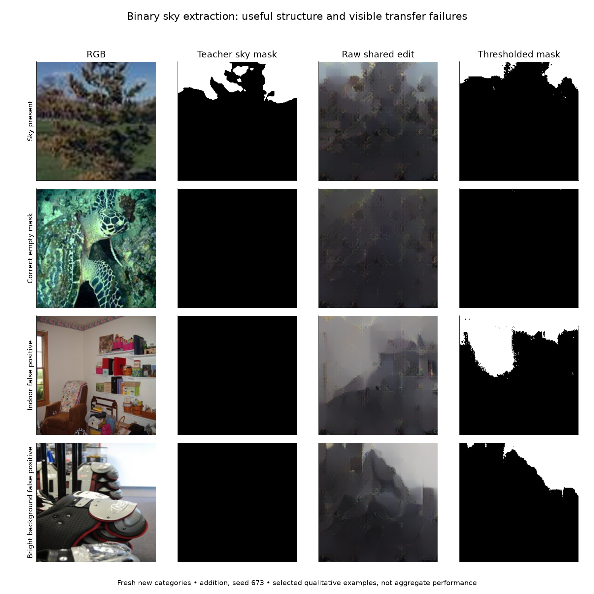
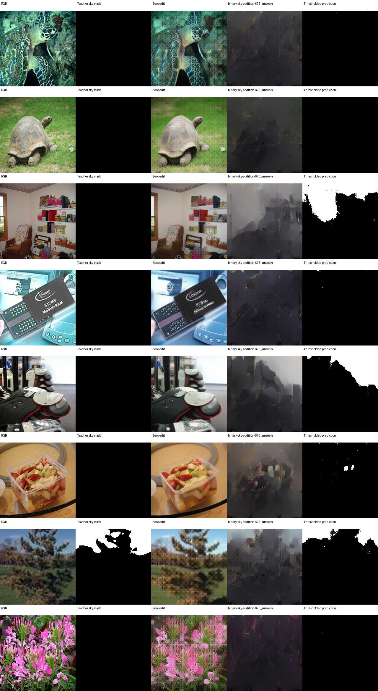
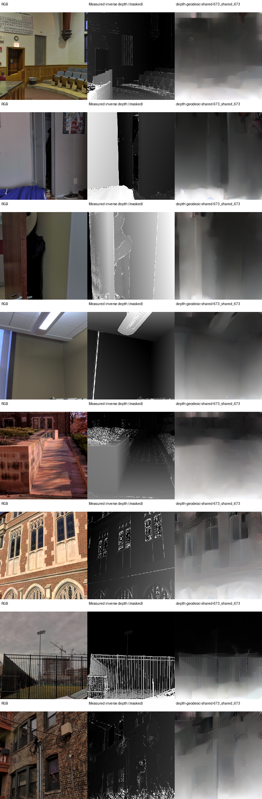
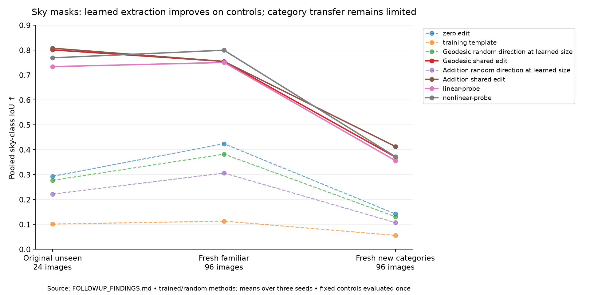
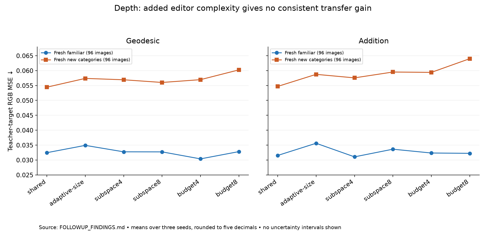

# Follow-up visual results

Five new figures extend the [original visual results](../../intrinsics/assets/README.md).
Original figures are linked rather than copied. Qualitative examples use seed 673;
charts report three-seed means where applicable. Teacher masks and depth targets are
predictions, except for the explicitly measured DIODE depth.

## 1. Sky-mask successes and failures

Four examples selected from figure 2: sky detection, a correct empty mask, and two
false positives. Columns show RGB, teacher sky mask, raw edited output, and the
saved thresholded prediction (mean RGB threshold 0.5). The frozen decoder retains
texture; thresholding produces the binary mask. These selected examples illustrate
behavior and do not estimate its frequency. This panel intentionally reuses four
rows of the full audit below for readability.

## 2. Full fresh-category sky audit

Unmodified saved grid, addition seed 673, fresh new-category images. Columns:
RGB, teacher sky mask, zero edit, raw learned edit, thresholded prediction. Empty
teacher masks are genuine sky-absent examples, not missing labels. False positives
on bright indoor/background regions expose limited category transfer. The pooled
fresh new-category IoU averaged across three seeds is 0.4129; this eight-image grid
is illustrative, not the full 96-image evaluation.

## 3. Measured-depth transfer

Unmodified saved DIODE grid, shared geodesic seed 673. Columns: RGB, measured inverse
depth with invalid pixels blacked out, raw predicted output. Brighter measured
pixels indicate nearer surfaces; invalid black pixels must not be interpreted as
far depth. The reference display uses valid-pixel percentile normalization; raw
predictions are not displayed with the same normalization or validity mask. This
is a qualitative diagnostic, not a pixelwise error map. The figure shows coarse
structure and a strong bottom-bright pattern; aggregate measured-depth results
in the findings report establish weak transfer. It is a pilot, not calibrated
metric-depth evaluation or a full DIODE benchmark.

## 4. Sky-mask performance

Pooled sky-class IoU from the findings table, with three-seed means for trained
and random methods and single evaluations for fixed controls. The splits differ
in category composition; connected lines compare evaluation sets, not time or
controlled difficulty levels. Strong original-split results drop substantially
on fresh new categories. No uncertainty intervals are shown.

## 5. Depth and editor complexity

Teacher-target RGB MSE, averaged over three seeds, from the findings table. The
shared editor remains competitive with conditioned-size and direction-dictionary
variants. Variant order is categorical, not a uniformly increasing parameter
scale. These plots do not establish statistical equivalence; the findings report
provides the exploratory paired comparison and its limitations.

## Provenance and reproduction

Source grids (under ignored `experiments/intrinsics/outputs/followup-20261027/`):

- Figures 1–2: `sky-mask/fresh-addition-unseen.png`.
- Figure 3: `diode-first-check/depth-geodesic-shared-673_shared_673.png`.
- Figures 4–5: numeric tables in `../FOLLOWUP_FINDINGS.md`.

Run `python experiments/followup/assets/build_figures.py` from the repository root
with matplotlib, NumPy, and Pillow available, plus the original source grids.
Figures 2 and 3 are exact copies; figure 1 only selects/rearranges saved tiles.
No predictions were regenerated or altered. None of these five files duplicates
an image in the original tracked assets.
