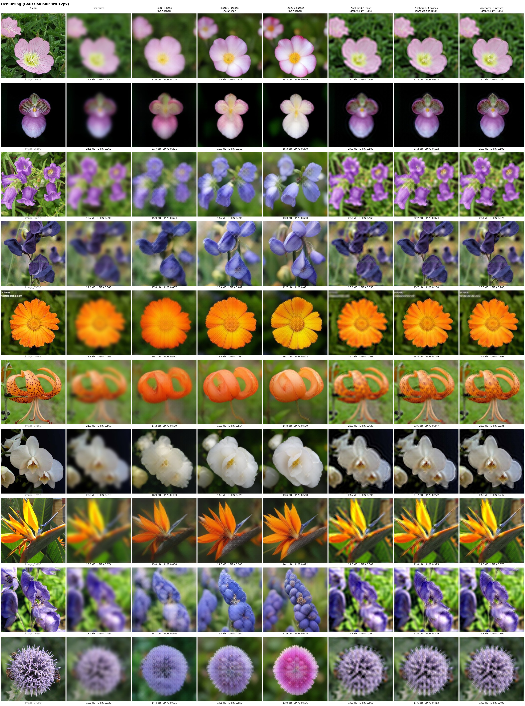
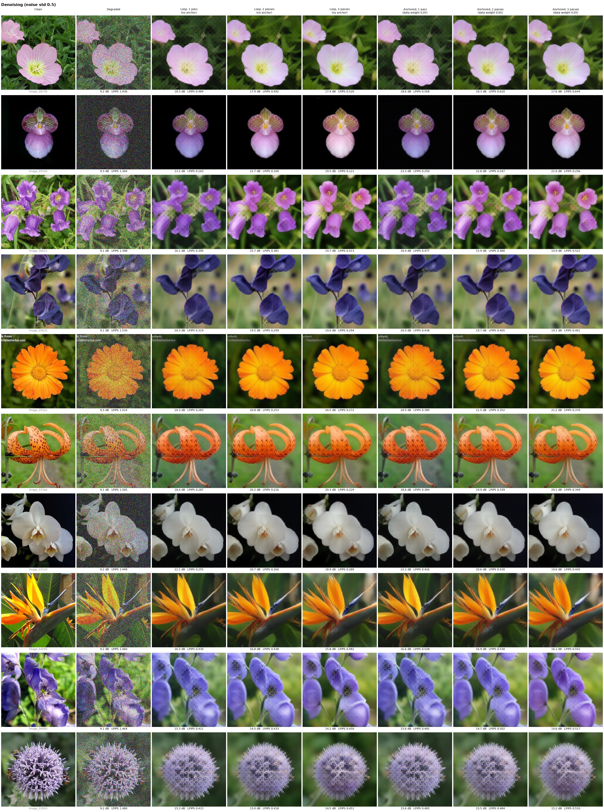
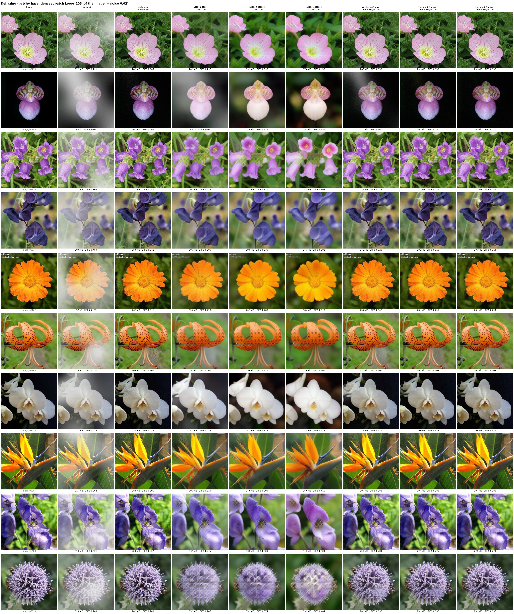
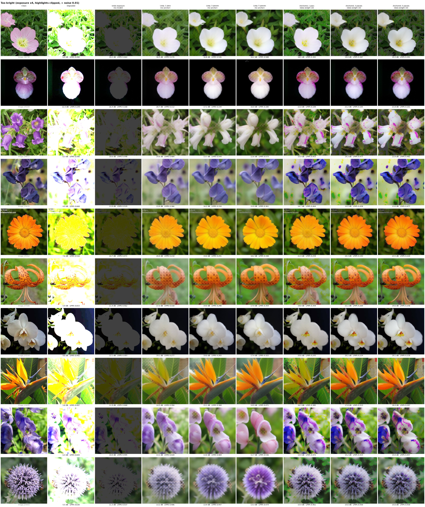

# Inverse problems with the Sphere Encoder

Can a pretrained Sphere Encoder repair a damaged image by looping

```
encode  ->  add a little noise to the latent  ->  decode
```

starting from the damaged image? We test four kinds of damage (blur, noise, haze, overexposure) at increasing strength, using the `sphere2-large-flowers-512px` checkpoint on Flowers-102.

Two versions of the loop are compared:

- **No anchor:** the plain encode, noise, decode loop.
- **Anchored:** the same loop, plus a data-consistency step after every decode. This is the closed-form proximal step from SP³ ([arXiv 2606.16396](https://arxiv.org/abs/2606.16396)):

  ```
  x <- argmin_x  mu * ||A(x) - y||^2 + ||x - decoded||^2
  ```

  Here `y` is the damaged image, `A` is the known damage, and `mu` (the *data weight*) sets how strongly the input is trusted. The step finds the image closest to the decoder's output that, damaged the same way, matches the input. The model can fill in what the damage erased, but it can't change what the input still shows.

For haze and overexposure we also report **undo, no model**: the known damage reversed by formula, with no model at all.

Open [`index.html`](index.html) in a browser for a page with these results, charts and figures.

## The damage

| Task | Strength | What the damage is |
| --- | --- | --- |
| Blur | Gaussian std 2 to 12px | Fine detail erased, shapes intact |
| Noise | Gaussian std 0.1 to 0.5 (pixels in [0, 1]) | Grain over every pixel |
| Haze | densest patch keeps 50% to 10% of the image | Patchy white haze (thickness varies smoothly across the image, a random pattern per image) + sensor noise std 0.02 |
| Too bright | exposure ×1.5 to ×4 | Brightness multiplied, then clipped at white + sensor noise std 0.01. At ×4 everything above 25% gray clips |

## At a glance

PSNR (dB, higher is better) / LPIPS (lower is better) against the clean image, 32 Flowers-102 validation images. "Ideal passes" is the pass with the lowest LPIPS for the recommended setting, across all strengths. The best result is at the heaviest strength.

| Damage | Use the anchor? | Ideal passes | Heaviest tested | Damaged | Best result |
| --- | --- | --- | --- | --- | --- |
| Blur | **yes**, weight 1000 | 3, up to 5 or 6 for heavy blur | 12px | 19.9 / 0.629 | 22.2 / 0.362 |
| Noise | **no**, it hurts | 1 | std 0.5 | 9.2 / 1.457 | 17.2 / 0.372 |
| Haze | **yes**, weight 25 | 2 to 5 | densest 10% | 11.3 / 0.366 | 28.2 / 0.254 |
| Too bright | **yes**, weight 10 | 1 or 2 | ×4 | 7.0 / 0.563 | 17.8 / 0.355 |

**Anchor or not.** The anchor helps exactly when the damage erases or hides information in a known way (blur, haze, clipping), so the input can pin down what it still shows. Noise corrupts every pixel equally, so there's nothing reliable to anchor to. There the anchor just mixes noise back in, and the model's single pass does all the work.

**Number of passes.** Without the anchor, every pass drifts toward "a typical flower", so the first pass is (almost) always best. With the anchor the curve improves, then flattens, and it never collapses. The heavier the damage, the more passes help. Light blur is done by pass 3, while 12px blur is still improving slowly at pass 6. Most of the gain always comes by pass 3.

**Strength.** All gains shrink as the damage grows, because more of the image is the model's guess. Light blur and light overexposure come back nearly perfect (34.8 dB at 2px blur, 29.7 dB at ×1.5). At the heaviest settings the results are clearly better than the input, but fine detail and clipped colors are invented.

## Results by task

All tables use 32 validation images and show PSNR / LPIPS, with the best pass in parentheses. The figures show the first 10 validation images (one per flower class) at the heaviest strength. Each tile is labeled with its own PSNR / LPIPS.

### Blur

| Blur std | Damaged | No anchor: best (pass) | Anchored, weight 1000: best (pass) |
| --- | --- | --- | --- |
| 2px | 28.6 / 0.249 | 20.5 / 0.216 (1) | **34.8 / 0.044** (3) |
| 4px | 24.4 / 0.435 | 19.5 / 0.285 (1) | **28.0 / 0.144** (3) |
| 6px | 22.5 / 0.526 | 17.9 / 0.412 (1) | **25.3 / 0.221** (4) |
| 8px | 21.3 / 0.575 | 15.8 / 0.490 (2) | **23.9 / 0.278** (5) |
| 12px | 19.9 / 0.629 | 14.2 / 0.568 (3) | **22.2 / 0.362** (5) |

- **The anchor is essential.** Without it, PSNR falls 4 to 8 dB *below* the blurred input at every strength, and the flower turns into a different one. With it, the result beats the input on both metrics at every strength.
- **Heavier blur needs more passes** (3 at 2 to 4px, 5 or 6 at 8 to 12px), with most of the gain by pass 3.
- **Trust the input strongly.** Weight 1000 beats weight 25 at every strength. This relies on the blurred image having no noise of its own. With noise added, a weight around 5 was best in an earlier test.



### Noise

| Noise std | Damaged | No anchor: best (pass) | Anchored, weight 0.05: best (pass) |
| --- | --- | --- | --- |
| 0.1 | 20.5 / 0.621 | 20.4 / **0.230** (1) | 20.8 / 0.237 (1) |
| 0.2 | 15.1 / 0.991 | 19.6 / **0.260** (1) | 19.9 / 0.293 (1) |
| 0.3 | 12.2 / 1.236 | 18.7 / **0.295** (1) | 19.0 / 0.355 (1) |
| 0.4 | 10.3 / 1.379 | 17.9 / **0.333** (1) | 18.1 / 0.417 (1) |
| 0.5 | 9.2 / 1.457 | 17.2 / **0.372** (1) | 17.4 / 0.473 (1) |

- **One pass, no anchor, at every strength.** Even at std 0.5 one pass gives a clean image.
- **The anchor hurts.** PSNR rises by 0.2 to 0.4 dB, but LPIPS gets worse, and the gap grows with the noise (0.007 at std 0.1, 0.10 at std 0.5).
- **Each extra pass costs about 1 dB and 0.03 LPIPS** as colors and shapes drift.



### Haze

| Densest patch keeps | Damaged | Undo, no model | No anchor: best (pass) | Anchored, weight 25: best (pass) |
| --- | --- | --- | --- | --- |
| 50% | 16.4 / 0.206 | 31.4 / 0.168 | 19.7 / 0.231 (1) | **31.7 / 0.161** (2) |
| 30% | 13.5 / 0.273 | 29.7 / 0.212 | 18.9 / 0.243 (1) | **30.2 / 0.200** (4) |
| 20% | 12.3 / 0.316 | 28.6 / 0.242 | 18.5 / 0.252 (1) | **29.3 / 0.225** (5) |
| 10% | 11.3 / 0.366 | 26.9 / 0.282 | 18.0 / 0.262 (1) | **28.2 / 0.254** (4) |

- **Knowing the haze does most of the work.** Undoing it by formula, with no model, already gives 27 to 31 dB.
- **The anchored loop adds a modest gain that grows with the haze** (+0.3 dB at 50%, +1.3 dB at 10%), by cleaning up the sensor noise that undoing dense haze amplifies.
- **Without the anchor the model barely dehazes** (18 to 20 dB) and drifts after pass 1.
- Weight 5 gives a better LPIPS than 25 but loses PSNR, falling below the no-model undo in dense haze.
- The haze pattern is synthetic, because flower close-ups have no real depth to derive haze from.



### Too bright

| Exposure | Damaged | Undo, no model | No anchor: best (pass) | Anchored, weight 10: best (pass) |
| --- | --- | --- | --- | --- |
| ×1.5 | 15.0 / 0.144 | 23.7 / 0.111 | 20.6 / 0.215 (1) | **29.7 / 0.071** (1) |
| ×2 | 11.1 / 0.285 | 17.2 / 0.245 | 19.6 / 0.241 (1) | **24.6 / 0.148** (2) |
| ×3 | 8.2 / 0.459 | 12.7 / 0.415 | 17.3 / 0.311 (1) | **20.2 / 0.269** (2) |
| ×4 | 7.0 / 0.563 | 10.9 / 0.518 | 15.7 / 0.375 (1) | **17.8 / 0.355** (2) |

- **The anchor helps most for mild overexposure.** At ×1.5 the result is close to the original. At ×4 it only edges out the plain loop on LPIPS.
- **Clipped colors can't be recovered.** Wherever a region blew out to pure white, its color is the model's guess (the pink evening primrose comes back white). Where only some color channels clipped, the guess can leave color streaks.
- **1 or 2 passes.** Later passes slowly get worse.
- Undoing the exposure with no model turns blown-out regions flat gray.



## Setup

```bash
conda create -n sphere python=3.10 -y && conda activate sphere
pip install torch torchvision --index-url https://download.pytorch.org/whl/cu128
pip install -r requirements.txt rich lpips torchmetrics   # rich is missing from requirements.txt
```

Data and weights go under `workspace/`, which is gitignored:

- **Checkpoint:** `workspace/experiments/sphere2-large-flowers-512px/` (`cfg.json` + `ckpt/ep1999.pth`), from [tomg-group-umd/sphere2](https://huggingface.co/tomg-group-umd/sphere2).
- **Flowers-102:**
  - unpack [102flowers.tgz](https://www.robots.ox.ac.uk/~vgg/data/flowers/102/102flowers.tgz) into `workspace/datasets/flowers-102/` (giving `jpg/`)
  - add `train.json` and `val.json` from `flowers.json/` in the same HF repo
- **DINOv3 access:** the encoder is built on `facebook/dinov3-vits16plus-pretrain-lvd1689m`, which is gated. Request access on its HF page, then point to your token:

  ```bash
  export HF_TOKEN_PATH=/path/to/your/hf/token
  ```

## Reproducing

Each command runs on one GPU. The analysis takes a few minutes per task, and a figure about 30 seconds.

```bash
A="python inverse/run_inverse.py --split val --num_images 32 --num_grid 0"
$A --tasks deblur --levels 2 4 6 8 12 --mus 0 25 1000 --schedules 10x6 --eval_steps 1 2 3 4 5 6 --run_name analysis/deblur
$A --tasks denoise --levels 0.1 0.2 0.3 0.4 0.5 --mus 0 0.05 --schedules 10x5 --eval_steps 1 2 3 4 5 --run_name analysis/denoise
$A --tasks dehaze --haze_map patchy --meas_noise 0.02 --levels 0.5 0.3 0.2 0.1 --mus 0 5 25 --schedules 10x5 --eval_steps 1 2 3 4 5 --run_name analysis/dehaze
$A --tasks overexpose --meas_noise 0.01 --levels 1.5 2 3 4 --mus 0 10 --schedules 10x5 --eval_steps 1 2 3 4 5 --run_name analysis/overexpose

# averages over the 10 figure images (batch size 10 draws the same noise as the figure)
V="python inverse/run_inverse.py --split val --num_images 10 --batch_size 10 --num_grid 0"
$V --tasks deblur --levels 12 --mus 0 1000 --schedules 10x5 --eval_steps 1 3 5 --run_name strong10/deblur_12
$V --tasks denoise --levels 0.5 --mus 0 0.05 --schedules 10x3 --eval_steps 1 2 3 --run_name strong10/denoise_0.5
$V --tasks dehaze --haze_map patchy --meas_noise 0.02 --levels 0.1 --mus 0 25 --schedules 10x5 --eval_steps 1 3 5 --run_name haze/val10_undo
$V --tasks overexpose --meas_noise 0.01 --levels 4 --mus 0 10 --schedules 10x5 --eval_steps 1 3 5 --run_name exposure/over_val10

# figures (defaults match the ones above)
for t in deblur denoise dehaze overexpose; do python inverse/make_figure.py --task $t; done

# tables above + the data block of index.html
python inverse/summarize.py
```

`run_inverse.py` writes `summary.md`, `summary.csv` and `metrics.csv` (per image) to `workspace/inverse/<checkpoint>/<run_name>/`. A schedule string sets the latent noise angle of each pass: `"10x6"` is 6 passes at 10°, `"60-15x4"` is 4 passes going from 60° down to 15°. `--mus 0` is the plain loop.

`run_inverse.py` also supports `--tasks underexpose` (too dark: exposure ×0.15 to ×0.05 + sensor noise). It behaves like noise, because brightening amplifies the sensor noise, so one pass with no anchor is best.

| File | What it does |
| --- | --- |
| `run_inverse.py` | damage models, the restoration loop with the anchor, metrics, sweeps |
| `make_figure.py` | the labeled figures above |
| `summarize.py` | the tables above, and the data block of `index.html` |
| `index.html` | results page |
| `figures/` | the four figures (JPEG copies of the full-size PNGs) |
