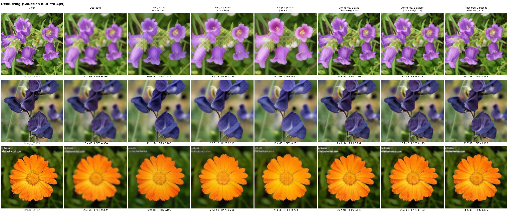
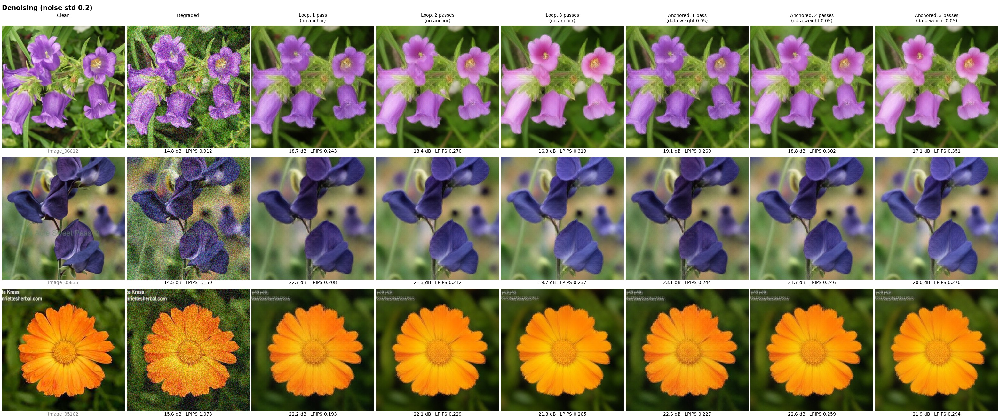

# Inverse problems with the Sphere Encoder

Can a pretrained Sphere Encoder restore degraded images (denoising, deblurring) by looping

```
encode  ->  add a little noise to the latent  ->  decode
```

starting from the degraded image?

We test two versions, using the `sphere2-large-flowers-512px` checkpoint on Flowers-102 validation images:

- **Loop:** the plain encode → noise → decode loop.
- **Anchored:** the same loop, plus a data-consistency step after every decode. This is the closed-form proximal step from SP³ ([arXiv 2606.16396](https://arxiv.org/abs/2606.16396)). It pulls the image back toward agreement with the degraded input:

  ```
  x <- argmin_x  mu * ||A x - y||^2 + ||x - decoded||^2
  ```

  Here `y` is the degraded image, `A` is the degradation (identity for noise, a Gaussian blur for blur), and `mu` sets how strongly the input is trusted. For blur the step is solved exactly with FFTs.

## Results

PSNR (dB, higher is better) / LPIPS (lower is better) against the clean image. Means over 32 train images. These are the same images used to choose the anchor weights, so the numbers are slightly optimistic.

| Task | Degraded | Best setting | Result |
| --- | --- | --- | --- |
| Denoising (noise std 0.2) | 15.1 / 0.991 | loop, **1 pass** (no anchor) | 19.4 / 0.265 |
| Deblurring (blur std 4px) | 24.2 / 0.443 | anchored (mu=25), **2 passes** | 25.8 / 0.203 |

**Findings:**

- **The plain loop drifts.** Every pass pulls the image toward "a typical flower" rather than *this* flower. By about 5 passes the flower's color and shape change, and PSNR/LPIPS get worse with every pass.
- **Deblurring needs the anchor.** With it, the result is sharper than the input *and* closer to the original on both metrics. It stays stable over passes. The best result comes at 2 passes, and later passes change almost nothing.
- **Denoising works in one pass, without the anchor.** Any useful anchor weight also brings the noise back, and extra passes only add drift.
- **Iterating barely helps.** At most one extra pass is worth it (deblurring).
- **Noise angle barely matters.** Latent noise angles from 0° to 30° made little difference; the figures use 10°.
- **Dehazing isn't a fair test yet.** `run_inverse.py` supports it, but with uniform haze of known strength the anchor alone inverts it exactly, so the model isn't doing the work. A real test needs haze that varies across the image or has unknown strength.

### Deblurring



### Denoising



## Setup

```bash
conda create -n sphere python=3.10 -y && conda activate sphere
pip install torch torchvision --index-url https://download.pytorch.org/whl/cu128
pip install -r requirements.txt rich lpips torchmetrics   # rich is missing from requirements.txt
```

Data and weights go under `workspace/`, which is gitignored:

- **Checkpoint:** `workspace/experiments/sphere2-large-flowers-512px/` (`cfg.json` + `ckpt/ep1999.pth`), from [tomg-group-umd/sphere2](https://huggingface.co/tomg-group-umd/sphere2).
- **Flowers-102:**
  - unpack [102flowers.tgz](https://www.robots.ox.ac.uk/~vgg/data/flowers/102/102flowers.tgz) into `workspace/datasets/flowers-102/` (giving `jpg/`)
  - add `train.json` and `val.json` from `flowers.json/` in the same HF repo
- **DINOv3 access:** the encoder is built on `facebook/dinov3-vits16plus-pretrain-lvd1689m`, which is gated. Request access on its HF page, then point to your token:

  ```bash
  export HF_TOKEN_PATH=/path/to/your/hf/token
  ```

## Usage

```bash
# figures (3 val images, passes 1-3, ~20 s each)
python inverse/make_figure.py --task deblur
python inverse/make_figure.py --task denoise

# metrics sweep: schedules x anchor weights, scored at intermediate passes
python inverse/run_inverse.py --tasks deblur --levels 4 --split train --num_images 32 \
    --schedules 10x6 --mus 0 25 --eval_steps 1 2 3 4 5 6 --run_name passes_deblur
```

`run_inverse.py` writes `summary.md`, `summary.csv`, `metrics.csv` (per image) and image grids to `workspace/inverse/<checkpoint>/<run_name>/`.

A schedule string sets the noise angle for each pass:

| Schedule | Meaning |
| --- | --- |
| `"10x6"` | 6 passes at 10° |
| `"30"` | one pass at 30° |
| `"60-15x4"` | 4 passes going from 60° down to 15° |

`--mus 0` gives the plain loop.

| File | What it does |
| --- | --- |
| `run_inverse.py` | degradations, the restoration loop, metrics, sweeps |
| `make_figure.py` | the labeled loop-vs-anchored figures above |
